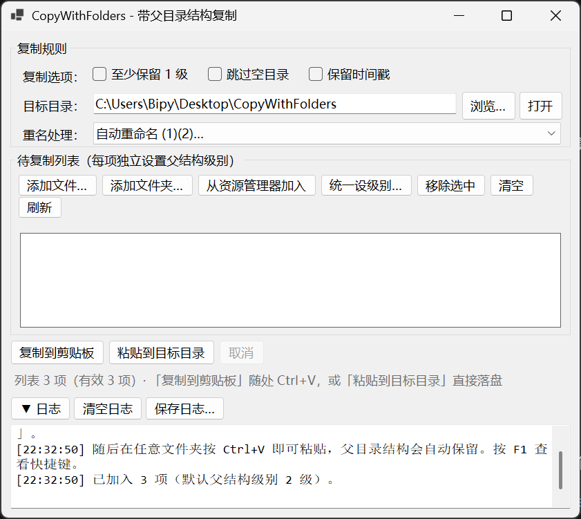
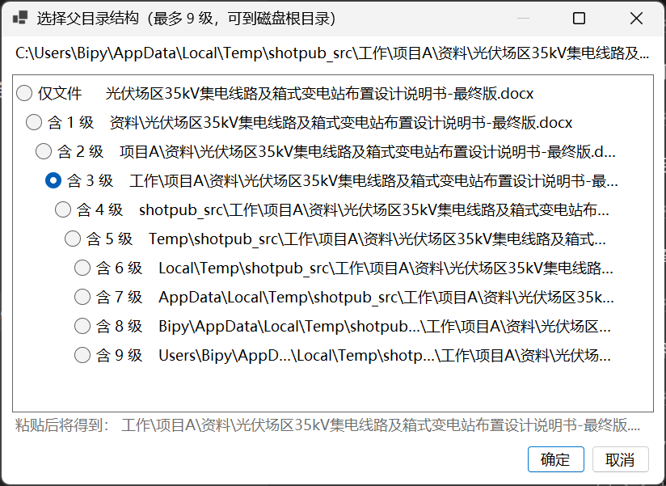
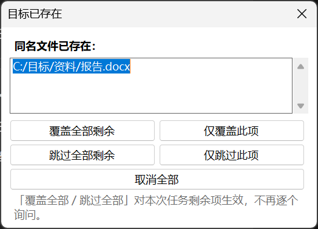

# CopyWithFolders

[](LICENSE)
[](https://github.com/ARichBegger/CopyWithFolders/releases)
[](https://dotnet.microsoft.com/)
[](https://github.com/ARichBegger/CopyWithFolders/releases)

**带父目录结构复制** —— 复制文件时连同它的上级目录一起带走，让"粘贴出来就是你要的层级"。

Windows 资源管理器复制文件只会带走文件本身。当你需要把
`工作\项目A\资料\报告.docx` 发给同事、或者归档到另一个工程的对应位置时，
必须手动建好 `项目A\资料` 再放进去。这个工具解决的就是这一步。

它会在复制前把目录结构**固化**下来写进系统剪贴板，
之后你在任何文件夹按 `Ctrl+V`，得到的就是完整层级。



## 核心特性

- **逐项设置父结构级别** —— 列表里每一行都可以单独设定要保留几级目录，
  一直可以选到磁盘根目录，不需要自己数层数
- **复制到剪贴板** —— 写入 `CF_HDROP`（Windows 原生文件拖放格式），
  在任意文件夹 `Ctrl+V` 即可，父结构自动保留
- **直接落盘** —— 也可以指定目标目录直接复制，适合批量归档
- **目录级冲突策略** —— 自动重命名 / 覆盖 / 每次询问 / 跳过；
  「每次询问」支持「覆盖全部」「跳过全部」批量决策，上千个文件也只需点一次
- **结构完整性** —— 空目录保留、符号链接默认跳过（防成环）、
  支持超过 260 字符的长路径
- **可取消、有进度** —— 预扫描统计总量，确定进度条 + 实时日志 + 随时中断
- **绿色单文件** —— 1 个 exe，运行时内置，免安装、不写注册表、不需要管理员权限

## 截图

| 选择父目录结构 | 同名冲突处理 |
|---|---|
|  |  |

> 级别选择窗口会把每一级目录名单独展示。超长的名字用 `…` 省略，
> 短目录名保持完整；拉宽窗口就能看到更多字符。

## 快速开始

### 方式一：直接下载（推荐）

到 [Releases](https://github.com/ARichBegger/CopyWithFolders/releases) 下载
`CopyWithFolders.exe`，双击即可运行。

- 程序未做代码签名，首次运行可能出现 SmartScreen 提示：
  点「更多信息」→「仍要运行」
- 运行时已内置，目标机**不需要安装 .NET**

### 方式二：从源码构建

需要 [.NET 8 SDK](https://dotnet.microsoft.com/download/dotnet/8.0)。

```bash
git clone https://github.com/ARichBegger/CopyWithFolders.git
cd CopyWithFolders

# 一键构建（跑测试 + 发布单文件）
pwsh ./build.ps1
```

产物位于 `dist/CopyWithFolders.exe`。

也可以手动执行：

```bash
dotnet publish src/CopyWithFolders/CopyWithFolders.csproj \
  -c Release -r win-x64 --self-contained true \
  -p:PublishSingleFile=true -p:EnableCompressionInSingleFile=true \
  -p:IncludeNativeLibrariesForSelfExtract=true \
  -o dist
```

## 使用说明

### 基本流程

1. **加入待复制项**：把文件/文件夹拖进窗口，或用
   `添加文件…` / `添加文件夹…` / `从资源管理器加入`（`Ctrl+E`）
2. **设置父结构级别**：单击该行的「父结构级别」列，在弹出的层级表里点选
   （选中多项后按 `Enter` 可批量设置）
3. **输出**，二选一：
   - 点 **复制到剪贴板**（`Ctrl+Enter`）→ 到目标文件夹按 `Ctrl+V`
   - 点 **粘贴到目标目录**（`Ctrl+Shift+Enter`）→ 直接落到上方指定的目录

### 关于父结构级别

假设文件位于 `C:\工作\项目A\资料\报告.docx`：

```
仅文件      报告.docx                     → 目标\报告.docx
含 1 级     资料\报告.docx                 → 目标\资料\报告.docx
含 2 级     项目A\资料\报告.docx            → 目标\项目A\资料\报告.docx
含 3 级     工作\项目A\资料\报告.docx       → 目标\工作\项目A\资料\报告.docx
```

级别上限就是磁盘根目录，不会固定在某几级。

**级别选择窗口的操作提示：**

- 窗口可自由拉伸，可见字符随宽度自动重算
- 超长的目录名单独用 `…` 省略，短名字不会被连累压缩
- 鼠标悬停可查看完整路径
- **点击窗口外的任何位置即取消**，不必找取消按钮或按 `Esc`
- `↑` `↓` `Home` `End` 切换，`Enter` 确认

### 同名冲突策略

| 策略 | 行为 |
|---|---|
| 自动重命名 | 目标已存在时追加 `(1)`、`(2)`…（默认） |
| 覆盖已有 | 直接覆盖（会先去掉只读属性） |
| 每次询问 | 弹出批量询问框，可选「覆盖全部 / 仅覆盖此项 / 跳过全部 / 仅跳过此项 / 取消全部」 |
| 跳过已有 | 目标已存在则跳过 |

策略对**目录层级同样生效**：选「自动重命名」时，同名目录会被整体改名成
`目录名 (1)`，而不是把两个目录的内容混在一起。

### 复制选项

- **至少保留 1 级** —— 当某项级别为「仅文件」时，也强制保留一层目录，
  避免多个文件全散落到目标根目录
- **跳过空目录** —— 复制后若目标目录仍为空则回收，不产生空壳目录
- **保留时间戳** —— 同步文件与目录的最后修改时间

### 快捷键

| 快捷键 | 功能 |
|---|---|
| `Ctrl+O` / `Ctrl+Shift+O` | 添加文件 / 添加文件夹 |
| `Ctrl+E` | 从资源管理器加入 |
| `Ctrl+Enter` / `Ctrl+Shift+Enter` | 复制到剪贴板 / 粘贴到目标目录 |
| `Delete` | 移除选中项 |
| `Ctrl+A` / `Ctrl+C` | 全选 / 复制完整路径 |
| `Enter` | 批量设置父结构级别 |
| `Ctrl+L` / `F1` | 折叠日志 / 查看帮助 |

## 配置项

设置保存在 exe 同目录的 `settings.json`，随 exe 一起移动即"设置随身走"。
若该目录不可写（如放在 `Program Files`），自动回退到
`%AppData%\CopyWithFolders\settings.json`。

```jsonc
{
  "DestFolder": "C:\\Users\\你\\Desktop\\CopyWithFolders", // 「粘贴到目标目录」的默认位置
  "CollisionPolicy": 0,          // 0=自动重命名 1=覆盖 2=每次询问 3=跳过
  "WrapInFolder": false,         // 至少保留 1 级
  "SkipEmptyDirectories": false, // 跳过空目录
  "PreserveTimestamps": false,   // 保留时间戳
  "DefaultLevel": 2,             // 新增项的默认父结构级别
  "TrayHintShown": false,        // 首次最小化到托盘的提示是否已显示
  "RecentFolders": [],           // 最近使用过的目标目录（最多 5 条）
  "WindowX": -1, "WindowY": -1,  // 窗口位置，-1 表示居中
  "WindowW": 720, "WindowH": 760,
  "LogCollapsed": false
}
```

## 命令行参数

```bash
# 把路径追加到已运行实例的列表（可配合「发送到」快捷方式使用）
CopyWithFolders.exe --append "D:\a\b.docx" "D:\c\d.dwg"
```

若程序未运行则直接启动并载入这些路径；已在运行则通过临时文件把路径交接给已有实例。

## 系统要求

- Windows 10 / Windows 11（x64）
- 从 Releases 下载的版本无需预装运行时
- 从源码构建需要 .NET 8 SDK

## 工作原理

剪贴板的 `CF_HDROP` 格式只能携带一批**平铺的路径**，本身不带"相对路径"概念。
要做到"粘贴后保留父结构"，必须先把结构固化：

```
1. 按每项各自的级别，在 %TEMP%\CopyWithFolders\Stage\<时间戳> 物化出完整结构
      <Stage>\项目A\资料\报告.docx
      <Stage>\项目B\图纸\dwg\图1.dwg

2. 只把暂存树的【顶层条目】写进剪贴板
      <Stage>\项目A
      <Stage>\项目B

3. 用户 Ctrl+V，资源管理器把这两个顶层条目粘进当前目录
      目标\项目A\资料\报告.docx      ← 父结构完整保留
      目标\项目B\图纸\dwg\图1.dwg
```

写入走两条通路：优先 OLE `IDataObject`，失败时回退到手工构造的原生
`CF_HDROP`（`DROPFILES` 结构）。另附自定义格式 `CopyWithFolders.Structure`
记录元信息，其他程序会安全忽略。

**重要**：剪贴板是延迟读取的，粘贴那一刻才真正取文件，所以暂存目录不能立即删除。
程序只在启动时清理**超过 24 小时**的残留。
**复制后请不要强制结束进程**，否则剪贴板里的路径会失效。

## 项目结构

```
CopyWithFolders/
├── src/
│   ├── Shared/                    纯逻辑层（零 UI 依赖，可跨平台单测）
│   │   ├── CopyOptions.cs         策略、过滤、进度、结果模型
│   │   ├── CopyLogic.cs           路径层级、重名、递归复制、安全护栏
│   │   ├── Staging.cs             暂存树构建 + 过期清理
│   │   ├── IClipboardAccessor.cs  剪贴板抽象 + 内存实现
│   │   └── WindowsClipboard.cs    CF_HDROP / OLE 双通路
│   └── CopyWithFolders/           UI 层（WinForms）
│       ├── Program.cs             入口：高 DPI、单实例、命令行
│       ├── MainForm.cs            布局与事件编排
│       ├── UiMetrics.cs           界面度量（按字体实测，不写死像素）
│       ├── CopyScheduler.cs       进度 / 取消 / 冲突状态机 / 双模式
│       ├── PendingListModel.cs    列表模型：去重、状态、预览
│       ├── LevelPickerDialog.cs   级别选择器
│       ├── ConflictDialog.cs      批量冲突询问
│       ├── PrecheckDialog.cs      执行前预检确认
│       └── SettingsStore.cs       设置原子写 + 备份 + 回退
├── tests/
│   ├── CopyLogicTest/             核心逻辑测试（140 项断言）
│   └── UiLayoutTest/              界面排版审计 + 交互回归
├── docs/images/                   README 截图
└── build.ps1                      一键构建
```

**设计取向**：逻辑层刻意不引用任何 WinForms 类型，因此路径计算、冲突策略、
递归复制这些容易出错的部分可以在控制台里跑真实文件系统测试；
UI 层只负责编排，所有尺寸都通过 `UiMetrics` 按字体实测，不写死像素。

## 开发

```bash
# 核心逻辑测试（140 项，全部通过即 ALL TESTS PASSED）
dotnet run --project tests/CopyLogicTest -c Release

# 界面排版审计 + 交互回归（有问题时退出码非 0，需要交互式桌面会话）
dotnet run --project tests/UiLayoutTest -c Release
```

测试覆盖：路径层级算法、四种冲突策略（含批量决策的"仅询问一次"语义）、
目录级策略对齐、空目录保留与跳过、级别到根、符号链接与循环防护、
预扫描统计、取消令牌、暂存树构建与条目有效性、端到端粘贴校验、
长路径（>260 字符）、中文与特殊字符路径、目标目录自动创建。

界面侧额外校验：控件文字是否被裁切、列标题是否完整、子控件是否重叠或溢出、
级别窗口模态确认能否正确回传、点击窗口外能否关闭、逐段截断的自适应行为。

## 已知限制

- **仅 Windows**：剪贴板依赖 `CF_HDROP`，本质是 Windows 专有格式
- **管理员权限的资源管理器**：「从资源管理器加入」走 Shell COM，
  若资源管理器以管理员身份运行，请也用普通权限运行本程序（Windows UIPI 限制）
- **符号链接**：默认跳过，不复制链接本身
- **未签名**：首次运行会被 SmartScreen 拦一下

## 版本与发布

版本号遵循 [语义化版本](https://semver.org/lang/zh-CN/)，
变更记录见 [CHANGELOG.md](CHANGELOG.md)，发布流程见 [docs/RELEASING.md](docs/RELEASING.md)。

## 许可证

[MIT](LICENSE) © 2026 ARichBegger

---

## English

**CopyWithFolders** is a tiny portable Windows tool that preserves the parent
folder structure when copying files.

Explorer's copy gives you just the file. This tool lets you pick, per item,
how many parent levels to keep — then either writes them to the clipboard
(paste anywhere with `Ctrl+V` and the tree comes along) or copies straight
to a target folder.

**Highlights**: per-item level selection (up to the drive root), four collision
policies with batch decisions, empty-folder preservation, long-path support,
symlink-loop protection, cancelable with progress, and a single self-contained
`exe` with no install and no registry writes.

**Quick start**: grab `CopyWithFolders.exe` from
[Releases](https://github.com/ARichBegger/CopyWithFolders/releases) and run it.
Windows 10/11 x64. Build from source with .NET 8 SDK via `pwsh ./build.ps1`.

Licensed under [MIT](LICENSE).
